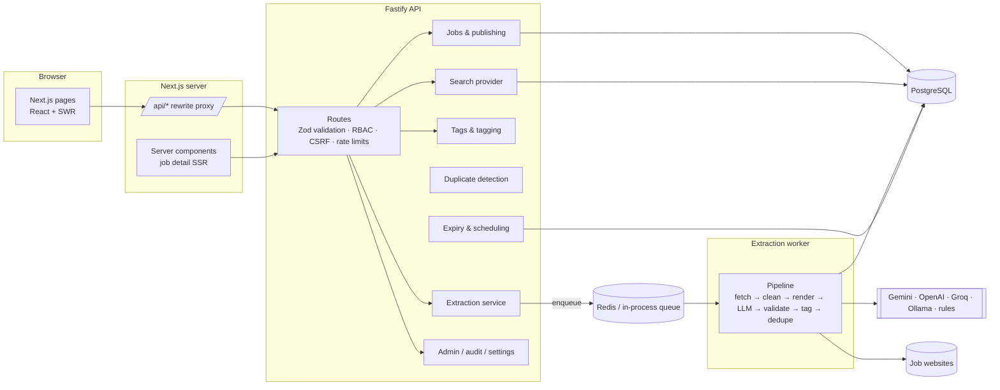

# Architecture

## Overview

A **modular monolith**: one Fastify API process with independently testable modules, a Next.js front end, and a shared TypeScript package holding the domain logic both sides need (schemas, taxonomy, tagging, formatting). Extraction runs on a queue — Redis/BullMQ in production (with a separate worker process), or an in-process queue for local development.



### Modules (`apps/api/src/modules`)

| Module | Responsibility |
|---|---|
| `auth` | Registration, login (bcrypt, timing-safe on unknown emails), session JWT in an httpOnly cookie, user management with role-hierarchy rules |
| `jobs` | The single publishing pipeline used by manual creation, editing and extraction: status resolution by role, company/skill upserts, tagging, expiry computation, post generation, search indexing, audit |
| `search` | `SearchProvider` interface; `PostgresSearchProvider` uses a weighted `tsvector` (title A, company/skills/tags B, description C) with prefix queries plus `ILIKE` for mid-word partial matches |
| `tags` | Taxonomy CRUD with near-duplicate protection (slug, normalised name, synonyms) and a cached active taxonomy |
| `duplicates` | Candidate pre-selection by URL keys / company / title, fuzzy scoring from `@jobs/shared` |
| `extraction` | SSRF guard, safe fetcher, Cheerio cleaner, Playwright renderer, grounding/normalisation, pipeline, queue, extraction service |
| `llm` | Provider adapters (REST, no SDKs), versioned prompts, JSON parsing, Zod validation, retries/fallbacks, pricing, rule-based extractor |
| `expiry` | Scheduled publishing, deadline/walk-in/default expiry, source re-verification |
| `admin` | Dashboard aggregation |
| `settings` | LLM + general settings stored in the `Setting` table (cached), defaults from env |
| `audit` | Append-only audit log (= publishing history) |

Dependencies are wired manually in `src/container.ts`; tests replace the fetcher, browser, queue, LLM providers and DNS resolver with fakes.

### Shared package (`packages/shared`)

Pure, framework-free TypeScript used by both API and web:
Zod input/query/LLM-output schemas · DTO types · enums and labels · default taxonomy · **tagging engine** · skill canonicalisation · experience parsing and buckets · tolerant date parsing · duplicate similarity (Dice + Jaccard) · **post formatter** · URL normalisation.

## Data model

```mermaid
erDiagram
  User ||--o{ Bookmark : saves
  User ||--o{ Job : "creates / approves"
  User ||--o{ Extraction : submits
  User ||--o{ AuditLog : performs
  Company ||--o{ Job : posts
  Job ||--o{ JobSkill : requires
  Skill ||--o{ JobSkill : ""
  Job ||--o{ JobTag : tagged
  Tag ||--o{ JobTag : ""
  Job ||--o{ JobSource : "sourced from"
  Job ||--o{ Bookmark : ""
  Job |o--o{ Extraction : "published from"
  Extraction ||--o{ ExtractionLog : logs

  User { string id PK; string email UK; string passwordHash; Role role; UserStatus status; datetime lastLoginAt }
  Company { string id PK; string name; string normalizedName UK; string website; string logoUrl }
  Job {
    string id PK; string companyId FK; string title; string normalizedTitle; string location
    WorkMode workMode; EmploymentType employmentType; string qualification; string experienceText
    float minExperience; float maxExperience; bool isFresherFriendly; string summary; text description
    string[] responsibilities; float salaryMin; float salaryMax; string currency; SalaryType salaryType
    string applicationUrl; string applicationUrlKey; string sourceUrl; string sourceUrlKey; string sourceWebsite
    date deadline; date walkInDate; date postedDate; string industry; int openings
    JobStatus status; SourceType sourceType; datetime publishedAt; datetime scheduledAt
    datetime expiresAt; datetime expiredAt; string expiryReason; text generatedPost; json fieldMeta
    text searchText; tsvector searchVector
  }
  Skill { string id PK; string name; string normalizedName UK }
  JobSkill { string jobId PK; string skillId PK; bool isPreferred }
  Tag { string id PK; string name; string slug; TagCategory category; string[] synonyms; bool isActive; bool isSystem }
  JobTag { string jobId PK; string tagId PK; TagSource source }
  JobSource { string id PK; string jobId FK; string sourceUrl; string extractedContentHash; datetime extractionTimestamp; datetime lastVerifiedAt; string lastVerifyStatus }
  Extraction { string id PK; string sourceUrl; string sourceUrlKey; ExtractionStatus status; string fetchMethod; string contentHash; json result; string error; int attempts }
  ExtractionLog { string id PK; string stage; LogStatus status; string provider; string model; string promptVersion; int promptTokens; int completionTokens; float estimatedCost; int durationMs; string errorMessage }
  Bookmark { string id PK; string userId FK; string jobId FK }
  AuditLog { string id PK; string action; string entityType; string entityId; json details }
  Setting { string key PK; json value }
```

Key indexes: `Job(status, publishedAt DESC)`, GIN on `Job.searchVector`, `Job(sourceUrlKey)`, `Job(applicationUrlKey)`, `Job(normalizedTitle)`, `Job(expiresAt)`, unique `Tag(category, slug)`, unique `Bookmark(userId, jobId)`, unique `Company.normalizedName`, unique `Skill.normalizedName`.

`*UrlKey` columns hold a protocol/`www`/tracking-parameter-insensitive URL fingerprint used for duplicate detection. Job statuses: `DRAFT → PENDING_APPROVAL → SCHEDULED → PUBLISHED → EXPIRED`, plus `ARCHIVED`. Jobs are never removed automatically.

## URL extraction workflow

```mermaid
sequenceDiagram
  actor Editor
  participant Web
  participant API
  participant Q as Queue
  participant W as Worker pipeline
  participant Site as Job website
  participant LLM

  Editor->>Web: paste URL
  Web->>API: POST /api/extractions
  API->>API: normalise URL, SSRF check (scheme, credentials, port, host, DNS)
  API->>API: note existing job with same source URL
  API->>Q: enqueue extraction (status QUEUED)
  API-->>Web: 202 + extraction id
  Web->>API: poll GET /api/extractions/:id
  Q->>W: run(id)
  W->>Site: robots.txt (cached 1h)
  W->>Site: GET page (throttled, ≤5 redirects each re-validated, size cap, timeout, retries)
  W->>W: Cheerio: JSON-LD JobPosting, meta, apply links; strip nav/ads/cookie banners/hidden text
  alt JS app shell or too little text
    W->>Site: Playwright render (every sub-request SSRF-checked; media blocked)
  end
  alt CAPTCHA or login wall
    W-->>API: FAILED — not bypassed, create manually
  end
  W->>LLM: versioned prompt, page content in untrusted delimiters
  LLM-->>W: JSON
  W->>W: Zod validation (repair retry → fallback provider → rule-based)
  W->>W: grounding checks · date/experience/skill normalisation · flags
  W->>W: tagging engine · duplicate candidates · post preview
  W-->>API: READY + result
  Editor->>Web: review / edit draft
  Web->>API: POST /api/extractions/:id/publish (or updateJobId)
  API->>API: shared publishing pipeline (role → status, duplicates gate, tags, expiry, index, audit)
```

## LLM integration

- **Abstraction**: `LlmProvider { complete({system, user, model, temperature, timeoutMs}) }`. Adapters call provider REST APIs directly (Gemini `generateContent` with `responseMimeType: application/json`; OpenAI/Groq chat completions with `response_format: json_object`; Ollama `/api/chat` with `format: json`).
- **Configuration**: provider, model, fallback provider/model, temperature, timeout, retries, input cap and prompt version are stored in the `Setting` table and editable in the admin UI. Defaults are derived from whichever API key is present; `gemini-2.5-flash-lite` is the default low-cost model.
- **Prompt versioning**: prompts live in `llm/prompts.ts` keyed by version (`job-extract@v1`); the version is recorded on every log row and extraction result.
- **Structured output**: `llmExtractionSchema` (Zod) is deliberately lenient per field — an invalid value degrades to `null` instead of failing the whole extraction — but a non-object reply triggers a repair retry.
- **Reliability**: transient errors (429, 5xx, timeouts) retry with exponential backoff; non-retryable errors (e.g. 401) move straight to the fallback; the rule-based extractor is always the final fallback so editors still get a reviewable draft.
- **Accounting**: each attempt writes an `ExtractionLog` row with tokens, estimated cost (per-model price table in `llm/pricing.ts`), latency and errors.
- **Never auto-publishes**: the pipeline stops at `READY`; publishing requires a human and respects the approval workflow.

### Anti-hallucination and prompt-injection defences

1. System prompt: extract only what is stated, `null` otherwise; never infer salary, experience numbers, qualifications, deadlines or URLs; treat page content as untrusted data.
2. Page content is wrapped in delimiters; delimiter look-alikes inside the content are stripped.
3. Visually hidden elements (`display:none`, `visibility:hidden`, `font-size:0`, `aria-hidden`) are removed before the text reaches the model.
4. Grounding checks after the model: salary numbers must appear on the page (with k/lakh/LPA/crore expansion) or they are removed; the application URL must be a link present on the page, otherwise the detected “Apply” link or the original URL is used — URLs are never rewritten or shortened; company name not found verbatim is flagged.
5. Inferred fields are reported (`fieldMeta.inferred`) and badged in the review UI; ambiguities, unparseable dates, inverted ranges and JSON-LD conflicts become review flags.
6. Tags suggested by the model are accepted only if they map onto the existing taxonomy.

## Tagging engine

Deterministic and data-driven (`packages/shared/src/tagging.ts`): experience buckets from min/max years (half-open ranges; `Freshers` when min is 0 or freshers are welcome), work mode and employment type from enums, skills by synonym/normalised-key match (including title scanning with ambiguous short terms excluded), qualifications by phrase match (generic “Any Graduation” dropped when a specific degree matches), job categories from title keywords (the category tags’ synonyms), then the LLM’s category, then a skill-based fallback; `Non-IT` is added for non-IT categories. Admins extend behaviour by editing tag synonyms — no code changes required.

## Security

| Concern | Control |
|---|---|
| AuthN | bcrypt (cost 11), JWT in `httpOnly`, `SameSite=Lax`, optionally `Secure` cookie; user and role re-loaded on every request (suspension/role changes apply immediately) |
| AuthZ | Role ranks `VIEWER < EDITOR < ADMIN < SUPER_ADMIN` enforced per route and inside services; admins cannot assign roles ≥ their own; last super admin protected |
| CSRF | Unsafe methods require an allow-listed `Origin` (when present) **and** `X-Requested-With: fetch` |
| Input | Zod on every body/query/param; URLs restricted to http(s) (prevents `javascript:` links); Prisma parameterised queries; raw SQL uses tagged templates |
| XSS | React escaping only; generated posts and descriptions rendered as text; external links `rel="noopener noreferrer nofollow"` |
| SSRF | Scheme/credential/port checks; blocked internal hostnames; every resolved address must be public unicast (no private, loopback, link-local/metadata, CGNAT, multicast, reserved, IPv4-mapped tricks); validation repeated inside the socket `lookup` (defeats DNS rebinding); manual redirects re-validated; Playwright routes every request through the same check |
| Abuse | Global rate limit (300/min), login/register (10/min), extraction submissions (20/min/user), per-host fetch throttling, response size and timeout caps |
| Secrets | API keys only in server env; settings endpoint reports `configured: true/false`; logs redact cookies/authorization |
| Headers | Helmet on the API; `X-Frame-Options`, `nosniff`, `Referrer-Policy`, `Permissions-Policy` on the web app |
| Audit | Every create/publish/approve/expire/delete/settings change is recorded |

Residual risk: Chromium performs its own DNS resolution, so the Playwright path relies on per-request checks rather than connect-time checks. In production run the API/worker with egress rules that deny private ranges (e.g. a network policy) for defence in depth.

## Assumptions and decisions

- **Auth**: The spec suggested Auth.js / Better Auth. Because the API is a standalone Fastify service, authentication is implemented in Fastify (bcrypt + signed JWT cookie, `@fastify/jwt`). The web app proxies `/api/*` so the cookie stays first-party.
- **UI kit**: Components follow shadcn/ui conventions (Tailwind + Radix primitives) but are hand-written in `apps/web/src/components/ui` rather than generated.
- **Editors** can create jobs and tags and submit URLs; publishing requires an Admin unless “Editors need approval” is turned off. Viewers can only browse and save.
- **No deadline ≠ active forever**: such jobs get `expiresAt = publishedAt + defaultExpiryDays` (30 by default, configurable).
- **Dates** are calendar dates (`YYYY-MM-DD`, stored as `DATE`); numeric dates are read day-first (DD/MM/YYYY), which suits Indian job postings.
- **Company logos** are hot-linked only when published in JSON-LD or clearly marked as a logo on the page; a generated monogram is used otherwise.
- **Search** is PostgreSQL FTS behind `SearchProvider`; swapping in OpenSearch means implementing `search()` and `reindex()`.
- **Short links**: the example post used a URL shortener, but the requirement “do not modify the application URL” wins — URLs are stored and shown verbatim.
